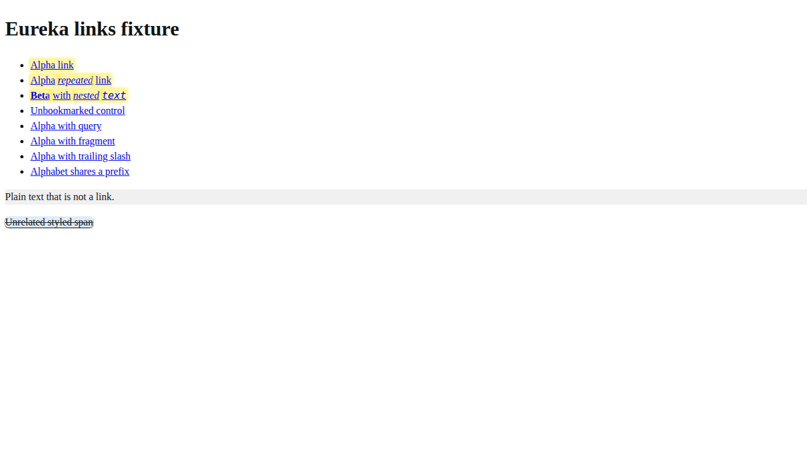

# PR #3 evidence

Evidence attached to
[PR #3](https://github.com/shihangw/eureka/pull/3) (Build extension from TypeScript
and add real-browser tests). There are two kinds of evidence, and they come from
different sources.

## Manual fixture screenshots

These are **manual** observations, not output from the automated test suites or
hosted CI. They were captured on 2026-10-20 with agent-browser during local manual
validation of the original PR head `ccf34b9`. The built `dist/` extension ran in an
isolated, disposable Chromium profile. That profile held only test bookmarks and
loaded the local fixture page `http://127.0.0.1:4310/pages/links.html`.

The page has three highlighted links: `Alpha link` and `Alpha repeated link` share
one bookmarked URL, and `Beta with nested text` uses a second. The other links are unbookmarked controls with a
query string, a fragment, a trailing slash, or a shared prefix, so they must stay
unhighlighted.

- Default yellow style, before any preference was saved:

  

- Glow style after saving it in the options page, closing the options page,
  reopening it from the popup, and loading the fixture again:

  

## Hosted automated tests

GitHub Actions run
[39536217720](https://github.com/shihangw/eureka/actions/runs/39536217720) passed on
2026-10-21 for original head `ccf34b9`, tested as synthetic merge
`e4123f28872d2481f2f88f11175ae20c1b4e856e` with base `18b12af`. Each job ran 48 unit,
4 real-Chromium integration, and 6 real-Chromium e2e tests with Chromium
156.0.8078.4:

- [Node 22.23.3 test step](https://github.com/shihangw/eureka/actions/runs/39536217720/job/119013354481#step:10:1)
- [Node 24.22.0 test step](https://github.com/shihangw/eureka/actions/runs/39536217720/job/119013354724#step:10:1)

That run covers only `ccf34b9`. It does not cover later commits on the branch, such
as the bookmark refresh fix. Those commits are covered by their own CI runs.
